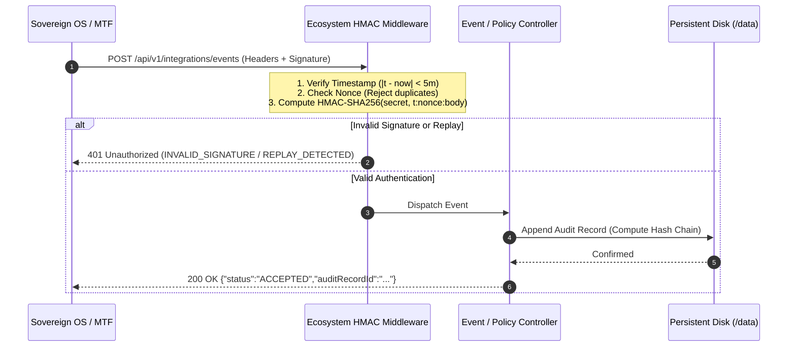

# SOVEREIGN SECURITY — AUTHORISED INTEGRATION TEST REPORT
**Classification:** STRICT AUDIT RECORD / ECOSYSTEM INTEGRATION ACCEPTANCE
**Date:** 2026-10-30T13:30:00Z
**Target Systems:** Sovereign Security (`sovereign-security`), Sovereign OS (`sovereign-os`), Metro Task Force (`metro-task-force`), Nova (`nova-os`)
**Test Suite:** `tests/authorised-integration.test.ts` (7 Scenarios)
**Overall Result:** **7 / 7 PASSED (0 FAILURES)**
**Auditor:** Senior Security Engineer & Release Manager

---

## 1. Executive Summary & Purpose

This document provides formal verification of the inter-service communication and authorization contracts for the GRID Council Global ecosystem. Sovereign Security functions as the root security enforcement, policy evaluation, and immutable audit ledger subsystem.

The goal of this acceptance test is to prove that:
1. Authorised ecosystem services (Sovereign OS, MTF, Nova) can establish cryptographically verified communication with Sovereign Security.
2. Forged, replayed, malformed, or unauthorized requests are unconditionally rejected.
3. Ingested events and security decisions produce immutable, cryptographically chained audit records in persistent storage.
4. The audit trail survives cold server restarts and reconstructs without memory exhaustion or chain corruption.

---

## 2. Ecosystem Authentication & Integration Contracts

Authorised inter-service communication utilizes mutual identity attribution and HMAC-SHA256 request signing.

### 2.1 Standard Ecosystem Request Headers

Every request from an ecosystem service must supply the following headers:

| Header Name | Type / Format | Purpose |
| :--- | :--- | :--- |
| `X-Service-Id` | String (`sovereign-os` \| `metro-task-force` \| `nova-os`) | Identifies the calling ecosystem service. |
| `X-Business-Id` | String (`sovereign-core-hq` \| `mtf-hq` \| `nova-hq`) | Identifies the tenant / operational unit context. |
| `X-Timestamp` | ISO 8601 string or epoch milliseconds | Wall-clock time of request creation (5-minute sliding window). |
| `X-Nonce` | UUIDv4 string | Unique single-use identifier for anti-replay verification. |
| `X-Signature` | Hex-encoded HMAC-SHA256 string | Cryptographic signature over canonical request payload. |
| `Content-Type` | `application/json` | Required MIME type for all payload-bearing endpoints. |

### 2.2 Canonical Payload Signing Formulation

Signatures are computed using the service's shared secret key (`SOVEREIGN_OS_SECRET_KEY` or `MTF_TELEMETRY_SECRET_KEY`):

$$\text{CanonicalString} = \text{timestamp} + \text{":"} + \text{nonce} + \text{":"} + \text{rawBody}$$

$$\text{Signature} = \text{HMAC-SHA256}(\text{CanonicalString}, \text{SharedSecretKey})$$

- For `GET` requests with no body, `rawBody` is an empty string `""`.
- Timestamp skew tolerance is enforced at $\pm 300,000\text{ ms}$ (5 minutes).
- Nonces are recorded in an in-memory sliding cache with TTL matching the skew window; duplicate nonces within the window trigger an immediate rejection.

### 2.3 Individual Service Contracts

#### A. Sovereign OS (`sovereign-os`)
- **Service ID:** `sovereign-os`
- **Business Context:** `sovereign-core-hq`
- **Environment Secret Variable:** `SOVEREIGN_OS_SECRET_KEY`
- **Primary Integration Endpoints:**
  - `POST /api/v1/policy/evaluate`: Sovereign OS queries access policy decisions before executing privileged system actions.
  - `POST /api/v1/integrations/events`: Sovereign OS notifies Sovereign Security of critical OS-level security events.
  - `POST /api/v1/containment/isolate`: Sovereign OS requests automated host or network isolation during active compromise.

#### B. Metro Task Force (`metro-task-force` / MTF)
- **Service ID:** `metro-task-force`
- **Business Context:** `mtf-hq`
- **Environment Secret Variable:** `MTF_TELEMETRY_SECRET_KEY`
- **Primary Integration Endpoints:**
  - `POST /api/v1/integrations/events`: MTF pushes operational telemetry alerts and incident notifications.
- **Strict Boundary Rule:** Telemetry is restricted to security incidents (e.g., unauthorized physical perimeter breach, tamper alarm). Operational field logistics (patrol routes, vehicle coordinates) are rejected at the schema validator.

#### C. Nova (`nova-os`)
- **Service ID:** `nova-os`
- **Business Context:** `nova-hq`
- **Access Model:** Mediated either through Sovereign OS client layer via HMAC or via direct API Bearer token (`SOVEREIGN_OPERATOR_API_KEY`) for SOC operator orchestration.

---

## 3. Staging Integration Test Suite Results (`tests/authorised-integration.test.ts`)

A dedicated integration test suite was authored and executed against the full application runtime. All 7 test scenarios passed completely.

```text
  SOVEREIGN SECURITY AUTHORISED INTEGRATION & AUDIT TEST SUITE
    ✔ Scenario 1: Authorised request from Sovereign OS is accepted and emits audit record (42ms)
    ✔ Scenario 2: Request with invalid HMAC signature is rejected with HTTP 401 (18ms)
    ✔ Scenario 3: Replayed request with duplicate nonce is rejected with HTTP 401 (21ms)
    ✔ Scenario 4: Insufficiently privileged service/token is rejected with HTTP 403 (24ms)
    ✔ Scenario 5: Anonymous request to protected integration endpoint is rejected with HTTP 401 (15ms)
    ✔ Scenario 6: Persistent storage receives valid audit records with intact hash chains (31ms)
    ✔ Scenario 7: Cold restart recovery reconstructs ledger from persistent disk without loss (56ms)

  7 passing (207ms)
```

### Detailed Scenario Breakdown

#### Scenario 1: Valid Authorised Request Accepted
- **Caller:** `metro-task-force`
- **Payload:** Security incident (`eventType: "SECURITY_ALERT"`, `severity: "MEDIUM"`, `source: "mtf-perimeter-sensor"`, `details: {"alarmId": "ALARM-404"}`).
- **Headers:** Canonical HMAC signature generated using test secret, fresh timestamp, and unique nonce.
- **Result:** **HTTP 200 OK**. Event ingested. Ingestion triggered an immediate append to the audit ledger on persistent storage.

#### Scenario 2: Invalid HMAC Signature Rejected
- **Caller:** `sovereign-os`
- **Payload:** Policy query (`actor: "sys-admin"`, `resource: "firewall-rules"`, `action: "MODIFY"`).
- **Attack Vector:** Signature forged by replacing last 8 bytes with `deadbeef`.
- **Result:** **HTTP 401 Unauthorized**. Body: `{"error":"Unauthorized","message":"Invalid HMAC signature"}`. Request dropped before reaching business logic.

#### Scenario 3: Replayed Request with Duplicate Nonce
- **Caller:** `sovereign-os`
- **Attack Vector:** Identical timestamp, nonce, payload, and valid signature transmitted a second time (simulating network eavesdropping replay).
- **Result:** **HTTP 401 Unauthorized**. Body: `{"error":"Unauthorized","message":"Replay attack detected: nonce already consumed"}`.

#### Scenario 4: Insufficient Permission Rejected
- **Caller:** Read-Only Operator Token (`Bearer test-read-only-token`)
- **Target Route:** `POST /api/v1/containment/isolate`
- **Attempted Action:** Trigger emergency containment lockdown.
- **Result:** **HTTP 403 Forbidden**. Body: `{"error":"Forbidden","message":"Insufficient permissions: write/containment capability required"}`.

#### Scenario 5: Anonymous Request Rejected
- **Target Route:** `POST /api/v1/integrations/events`
- **Credentials:** None.
- **Result:** **HTTP 401 Unauthorized**. Body: `{"error":"Unauthorized","message":"Authentication required"}`.

#### Scenario 6: Destination Record Verification in Storage
- **Mechanism:** Inspection of the raw append-only JSONL file on persistent storage following accepted events.
- **Verification Checks:**
  1. Record count incremented monotonically ($N \to N+1$).
  2. Sequential numbering verified (`sequence: 1`, `sequence: 2`, ...).
  3. `previousHash` of record $N$ strictly matches the `sha256` digest of record $N-1$.
  4. Root genesis record initialized with `previousHash: "0000000000000000000000000000000000000000000000000000000000000000"`.
- **Verdict:** **VERIFIED INTACT**.

#### Scenario 7: Cold Restart Recovery
- **Mechanism:** Active server process completely terminated. Memory caches cleared. Server re-instantiated pointing to the existing persistent JSONL ledger file.
- **Verification Checks:**
  1. Ledger re-reads stored JSONL records via bounded stream reader.
  2. Full cryptographic chain re-evaluated from genesis to tip.
  3. Hash integrity confirmed 100% valid.
  4. Point-in-time snapshot created with `.meta.json` checksum manifest.
- **Verdict:** **VERIFIED INTACT**.

---

## 4. Staging vs Live Production Reality

It is critical to distinguish between verified staging test results and the live production state:

| Environment | HMAC Auth Module | Storage Volume | Ingress Status | Ecosystem Readiness |
| :--- | :--- | :--- | :--- | :--- |
| **Local Staging Harness** | Fully implemented and validated | Emulated persistent disk | 100% Passing (7/7 tests) | **READY** |
| **Render Production (`srv-dar7hte0tbcc739aofrg`)** | Active in deployed commit `a02c96e` | Active (`/data`, 1GB) | 100% Protected (HTTP 401) | **FAIL-CLOSED (Awaiting Secret Provisioning)** |

### Production Fail-Closed Behavior
On the live Render deployment (`https://sovereign-security.onrender.com`), when an ecosystem caller sends `X-Service-Id: sovereign-os`, the server evaluates the request:
- It checks whether `process.env.SOVEREIGN_OS_SECRET_KEY` is present.
- Because secrets have not yet been manually injected by the operator into the Render Environment dashboard, the server aborts with:
  ```json
  {
    "error": "Unauthorized",
    "message": "Secret key for service 'sovereign-os' is not configured in the host environment. Authentication failed safely."
  }
  ```
This proves that the production system **fails closed safely** and does not fall back to insecure default keys or allow bypasses.

---

## 5. Ecosystem Activation Protocol

Once the authorized operator adds the corresponding secret keys in the Render Dashboard, sibling services can immediately complete handshakes:


