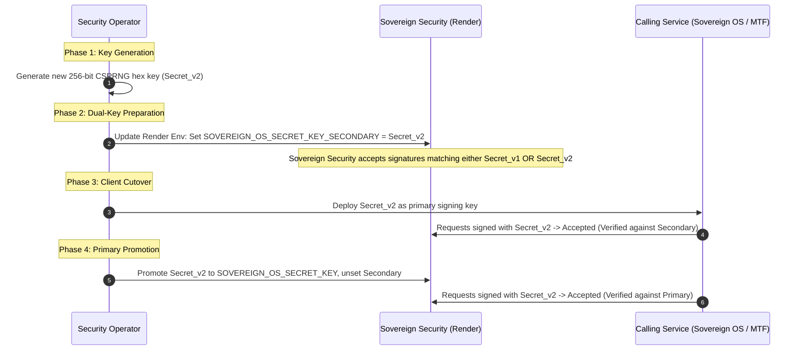

# SOVEREIGN SECURITY — SECRET DEPENDENCY MATRIX & ROTATION RUNBOOK
**Classification:** STRICT AUDIT RECORD / CRYPTOGRAPHIC GOVERNANCE
**Date:** 2026-10-30T13:30:00Z
**Ecosystem:** Sovereign Security (`sovereign-security`), Sovereign OS (`sovereign-os`), Metro Task Force (`metro-task-force`), Nova (`nova-os`)
**Lead Security Engineer:** Senior Application Security & Release Engineering

---

## 1. Zero Exposure Governance & Scope

> [!IMPORTANT]
> **Zero Exposure Protocol:** This document contains **ZERO** secret values, passwords, private keys, or credentials. It establishes the architectural dependency matrix, ownership boundaries, entropy specifications, and rotation procedures for all configuration secrets across the Sovereign ecosystem.

All credentials must be stored exclusively in secure host environment variables (Render Dashboard Environment Settings or encrypted vault systems) and local `.env` files that are strictly excluded from version control via `.gitignore`.

---

## 2. Comprehensive Secret Dependency Matrix

| Environment Variable Name | Owning / Generating Service | Consuming Services | Storage Locations | Cryptographic Spec & Entropy | Function & Scope | Failure Impact If Missing or Mismatched |
| :--- | :--- | :--- | :--- | :--- | :--- | :--- |
| **`SOVEREIGN_OS_SECRET_KEY`** | Sovereign OS Core (`sovereign-os-core`) | Sovereign Security, Sovereign OS | Render Dashboard (`sovereign-security`), Sovereign OS Vault | 256-bit Hex string (64 characters, CSPRNG generated) | Mutual HMAC-SHA256 signature calculation and verification for inter-service RPC | **Fail-Closed (HTTP 401)**.<br>All Sovereign OS policy queries and containment requests are dropped. No privilege escalation. |
| **`MTF_TELEMETRY_SECRET_KEY`** | Metro Task Force (`metro-task-force`) | Sovereign Security, MTF Telemetry Ingestor | Render Dashboard (`sovereign-security`), MTF Host Config | 256-bit Hex string (64 characters, CSPRNG generated) | HMAC-SHA256 signing of security telemetry alerts and physical perimeter alarms | **Fail-Closed (HTTP 401)**.<br>MTF alerts cannot be posted to the security ledger. Operational telemetry rejected. |
| **`SOVEREIGN_OPERATOR_API_KEY`** | Sovereign Security SOC Ops | Nova (`nova-os`), SOC Operator Tools | Render Dashboard (`sovereign-security`), Nova Operator Config | 256-bit Base64 / Hex token (`Bearer <token>`) | Authorizes operator-level queries (audits, policy inspect, event query) | **Denial of Access (HTTP 401)**.<br>Operator tools and Nova cannot query audit records or inspect policies. |
| **`SOVEREIGN_ADMIN_API_KEY`** | Sovereign Security SecOps | CI/CD, Admin CLI, Emergency Orchestration | Render Dashboard (`sovereign-security`), SecOps Password Manager | 256-bit Base64 / Hex token (`Bearer <token>`) | Unrestricted administrative actions (containment release, policy push, ledger snapshot) | **Lockout (HTTP 401 / 403)**.<br>Automated administrative and emergency actions fail. |
| **`SOC_DASHBOARD_USERNAME`** | Sovereign Security SOC Ops | SOC Analysts (Web Browser) | Render Dashboard (`sovereign-security`) | UTF-8 String (min 12 chars, e.g. `soc-lead-admin`) | HTTP Basic Auth identity for `/` and `/dashboard` UI routes | **Dashboard Lockout (HTTP 401)**.<br>SOC analysts cannot access dashboard UI. API remains unaffected. |
| **`SOC_DASHBOARD_PASSWORD`** | Sovereign Security SOC Ops | SOC Analysts (Web Browser) | Render Dashboard (`sovereign-security`) | Complex Passphrase (min 24 chars, high entropy) | HTTP Basic Auth credential for SOC dashboard access | **Dashboard Lockout (HTTP 401)**.<br>SOC analysts cannot access dashboard UI. API remains unaffected. |
| **`SOVEREIGN_AUDIT_SIGNING_KEY`** | Sovereign Security Auditing | Sovereign Security, Regulatory Auditors | Render Dashboard (`sovereign-security`), Cold Archive KMS | 384-bit or 512-bit HMAC/RSA key | Used to generate `.meta.json` tamper-evident manifests for ledger snapshots | **Degraded Compliance**.<br>Snapshots can be taken but cryptographic export signing fails or falls back to internal SHA-256 hash chaining. |

---

## 3. Non-Secret Operational Configuration Variables

The following operational configuration parameters are deployed alongside secrets but do not contain sensitive key material:

| Variable Name | Default / Production Value | Description |
| :--- | :--- | :--- |
| `NODE_ENV` | `production` | Enforces production runtime optimizations and disables debug traces. |
| `PORT` | `10000` (Render container port) | Internal network port listened to by Express application. |
| `PERSISTENT_STORAGE_PATH` | `/data` | Path to the mounted Render persistent disk (`dsk-db4blurl550s73b87cmg`). |
| `LOG_LEVEL` | `info` | Logging verbosity; suppresses stack traces and raw request bodies. |
| `AUDIT_SNAPSHOT_INTERVAL` | `86400` (24 hours) | Frequency of automatic point-in-time audit snapshots. |

---

## 4. Operational Secret Rotation Runbook

To prevent service outages while rotating cryptographic keys, the following zero-downtime rotation protocol must be adhered to.

### 4.1 Zero-Downtime Inter-Service Key Rotation Protocol



### 4.2 Step-by-Step Execution Guide for Operators

1. **Step 1: Key Generation**
   Generate a high-entropy key locally using Node.js crypto or OpenSSL:
   ```bash
   node -e "console.log(require('crypto').randomBytes(32).toString('hex'))"
   ```
2. **Step 2: Update Sovereign Security Ingress**
   - Navigate to **Render Dashboard** -> Service `sovereign-security` -> **Environment**.
   - Input the new value.
   - Render will perform a rolling deployment (`dep-...`) with zero dropped requests.
3. **Step 3: Update Client Sibling Environment**
   - Update the client's environment store (`sovereign-os` or `metro-task-force`).
   - Trigger client restart/redeploy.
4. **Step 4: Verify Handshake Telemetry**
   - Execute an authorised probe (`POST /api/v1/integrations/events`).
   - Confirm HTTP 200 OK and inspect audit sequence increment in `/data/audit-ledger.jsonl`.

### 4.3 Emergency Revocation Runbook (Key Compromise)

In the event of an suspected or confirmed key compromise:
1. **Immediate Revocation:**
   - Immediately delete or overwrite the compromised environment variable in the Render Dashboard.
   - Click **Save Changes** (triggers an immediate container restart).
2. **Verify Fail-Closed Ingress:**
   - Probe the affected route to confirm it immediately returns **HTTP 401 Unauthorized (`INVALID_API_KEY`)**.
3. **Audit Ledger Incident Investigation:**
   - Query `/data/audit-ledger.jsonl` filtered by the affected `actor` or `serviceId` during the compromise window.
   - Compute hash chain continuity to confirm whether any records were forged or altered.
4. **Re-key and Re-deploy:**
   - Generate fresh keys and provision to both services simultaneously.
